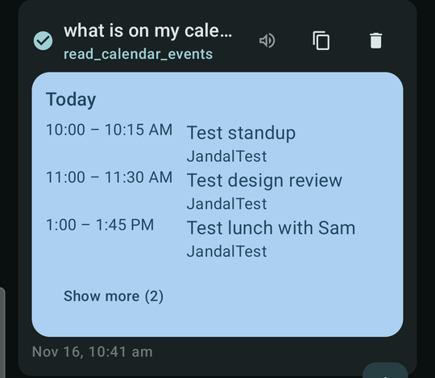
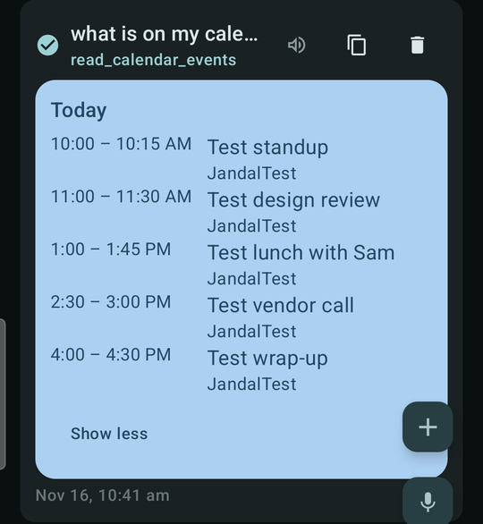

# #1942 calendar readout: chunk timing, cause of the gap, fixes

Device: S23U (`RFCW11265XH`, SM-S918B), debug build `ai.jandal.assistant.debug`, voice Cori high
(`vits-piper-en_GB-cori-high`, 22050 Hz, speed 0.85). Media volume 2 during runs (restored to 11).
Every run was one utterance at a time, with the app in the foreground on the Actions screen, unless the
row says otherwise. Device lock `/tmp/jandal-s23u.lock` held for the whole run.

Data: only made-up text, or the local test calendar `JandalTest` (account type LOCAL) with five made-up
events today: Test standup (10:00–10:15), Test design review (11:00–11:30), Test lunch with Sam
(13:00–13:45), Test vendor call (14:30–15:00), Test wrap-up (16:00–16:30). Calendar reads were limited to
`JandalTest` by the debug-only test-calendar filter (below), checked on screen (UI dump: only `Test …`
rows) before any readout was listened to or captured. No real event was read, shown or captured.

Logs: `VoiceTiming` (verbose logging, on by default in debug builds), one line per event:
`synth` (synthesis start/end, audio produced, rtf = synth ms / audio ms), `playStart` (with `gapMs` =
time from the previous chunk's playback end to this one's start), `playEnd`, `pause`, `discard`.
Source logs (not committed) were in `/tmp/s23u-1942-results/`.

Text formats:
- **old**: main's reply text, `10:00 AM to 10:15 AM: Test standup, on JandalTest.` The speech normaliser
  turns the colon into `. `, so the chunker's first boundary is right after `10:15 AM.`.
- **new**: this PR, `10:00 to 10:15 AM, Test standup.` (one sentence per event, no calendar name).

Chunks as queued by `speakInSentenceChunks` (characters before Sherpa's number spelling):

| Format | Chunk 0 | Chunk 1 |
|---|---|---|
| old | `You have 5 events today. 10:00 AM to 10:15 AM.` (46) | `Test standup, on JandalTest. 11:00 AM to 11:30 AM. Test design review, on JandalTest.` (85) |
| new, before the pause | `You have 5 events today. 10:00 to 10:15 AM, Test standup.` (57) | `11:00 to 11:30 AM, Test design review. 1:00 to 1:45 PM, Test lunch with Sam.` (76) |

## Measurements

rtf < 1 is faster than real time. `gapMs` is the silence the pipeline added between chunks
(0–1 ms = the next chunk was already waiting).

| Run | Threads | Text | rtf per chunk | Gap after chunk 0 | Later gaps |
|---|---|---|---|---|---|
| probe, old format | 2 | old | 0.63, 0.75, 0.79, 0.86 | **1659 ms** (between "10:15 AM" and "Test standup") | 0, 0 |
| probe, new format | 2 | new | 0.78, 0.84, 0.88 | **1247 ms** | 0 |
| real readout | 2 | new | 0.73, 0.80, 0.84 | **1050 ms** | 1 |
| probe, chat reply (3 sentences) | 2 | chat | 0.72, 0.79, 0.75 | 452 ms | 1 |
| probe, old format, **app in background** (Home) | 2 | old | 3.00, 3.22, 3.01 | **20623 ms** | 13280 ms |
| real readout ×3 | 4 | new | 0.46–0.56 | 1, 0, 0 ms | 1, 0, 0 ms |
| probe, old format | 4 | old | 0.41, 0.54, 0.53, 0.53 | 0 ms | 0, 0 |
| probe, chat reply | 4 | chat | 0.41, 0.49, 0.50 | 0 ms | 1 |
| **final build**, real readout ×3 (4 threads, pause, one event after it) | 4 | new | 0.40–0.56 | 2, 1, 1 ms | 0–1 ms |

Audible silence between parts, from the playback timestamps (`playStart(n+1) − playStart(n) − audioMs(n)`;
it includes the end-of-track latency padding, and excludes the new track's output latency, which was not
measured):

| Run | Intro → first event | Other boundaries |
|---|---|---|
| old format, 2 threads (before) | 1794 ms (no pause; this is the stall) | — |
| new format real readout, 2 threads | 1142 ms (no pause; stall) | — |
| final build, readouts 1–3 | 519, 560, 570 ms (400 ms `SpeechPause` + ~120–170 ms) | 87–158 ms |

## Stop and new utterance (stale synthesis)

Old-format probe started, then the new-format probe 0.5 s after the first one began playing:

| Build | New reply's first chunk (73 chars) | Superseded chunk |
|---|---|---|
| clean, nothing running | ~1910–2060 ms | — |
| 4 threads, before the callback | 3891 ms (rtf 0.96) | ran all three sentences (4938 ms), then discarded |
| final build | 3152 ms (rtf 0.71) | stopped after the sentence in progress (4381 of ~7000 ms audio), then discarded |

The sentence already running when the stop arrives still finishes; Sherpa cannot be interrupted inside one.

## Home mid-readout (final build)

Readout started, Home pressed 1.6 s into the first event (after the pause):

```
583.075  KEYCODE_HOME sent
583.459  ActionsScreen: lifecycle ON_STOP
583.468  pauseTransientVoiceUi reason=lifecycleOnStop keepSpeech=false
583.469  tts|speak_end|engine=SHERPA_EXPERIMENTAL|spoken=false|reason=STOPPED   (in-app event log)
583.551  AudioTrack: setVolume(0.000000, 0.000000)
583.585  VoiceTiming playEnd (30 ms fade, then pause + flush)
```

No later `playStart`; no `mCbf call back interval is abnormal` line. Crackle is a listening judgement and
was not judged by this run; it is on the owner's internal-testing smoke checklist. Before this run
`speak_end` logged `reason=[redacted]`: the event log keeps only enum constants, so the reason is now
passed as an enum. This run logged `STOPPED`; after review round 1, Home logs `INTERRUPTED_BACKGROUND`
(see the reason list below).

Rule (unchanged, #1918): Home or an app switch stops the readout; screen off keeps it speaking.

## Card

Actions card on the final build, test calendar only (3 rows in the compact Actions card, then Show more):

 

The first capture had a fixed 112 dp time column, and `10:15 AM` ran into the title at the S23U's font
size. The column is now as wide as the widest time on the card, plus 12 dp.

## Cause of the gap

1. **Synthesis of chunk N+1 is already overlapped with playback of chunk N** (producer/consumer with
   `audioQueue`, capacity 2): chunk 1's synthesis starts the millisecond chunk 0's ends. The gap is
   `synth(chunk 1) − play(chunk 0)`. Chunk 1 is 1.5–2× longer than chunk 0 (the chunker's minimum is 40
   characters for the first chunk and 72 after it), so at rtf 0.75–0.85 chunk 1 is not ready when chunk 0
   ends. After that the producer is ahead and later gaps are 0.
2. **The old format puts that boundary between the time and the title.** The colon after the time
   became a full stop, so chunk 0 ended at `10:15 AM.` and the gap fell before the event name, as the
   owner heard.
3. **There is no per-chunk model init or warm-up cost.** rtf is flat from 49 to 112 characters. Init
   runs once per process. It did run twice at once on first use (two `TTS initialised` lines); now
   serialised.
4. **The builder's "2.4–3× real time" was a background measurement.** Its probe ran with the app in the
   background (`onTrimMemory level=40`, `audio focus not granted`). Reproduced here: the same 63-character
   chunk took 10805 ms in the background (rtf 3.00) and 2275 ms in the foreground (rtf 0.63). Android
   limits a background app to the small cores. The builder's "hang" runs were the same, plus several
   overlapping utterances.
5. **A stopped utterance kept synthesising.** A native `generate()` cannot be interrupted. Starting a
   new readout 0.5 s into another (4 threads, before the fix) made the new reply's first chunk take
   3891 ms (rtf 0.96) instead of ~1950 ms; the stale chunk's result was then discarded. Not queued behind,
   but slowed by sharing the CPU.

The Honor's SoC is slower than the S23U's, so the same structure gives a longer gap there [INFERENCE: not
measured on the Honor]. With rtf ≈ 1.6 the old format's first boundary would be about
`1.6 × 7.2 s − 3.6 s ≈ 8 s`.

## Fixes in this PR

- Piper `numThreads` 2 → 4 (Kokoro already used 4): rtf 0.73–0.88 → 0.41–0.56 on the S23U.
- Spoken text: one sentence per event, time and title in one sentence, no calendar name.
- Pause after the count sentence (`SpeechPause`, 400 ms, a real silence in the Sherpa pipeline). The chunk
  after a pause is one sentence (`VOICE_AFTER_PAUSE_CHUNK_MIN_LENGTH`), so it is ready when the pause ends.
- Stale synthesis stops at the next sentence: streaming uses `generateWithCallback`, whose callback
  returns 0 once the utterance is no longer active.
- Sherpa init is `@Synchronized`.
- `speak_end` is logged when playback ends, with `reason=` `COMPLETED`, `STOPPED_BY_USER`,
  `INTERRUPTED_BACKGROUND` (Home or app switch), `REPLACED` (a new reply or one-shot speech), `STOPPED`
  (a stop with no recorded cause, e.g. the Settings voice sample) or `ERROR`. The Sherpa voices report how
  each streamed reply ended, so speech that was cut off is never logged as `COMPLETED`. `focus_loss` was not
  added: no voice stops on audio-focus loss today.
- Spoken `AM` is `A-M` (eSpeak reads the old `A M` as "uh em", i.e. "am"); `Jandal` is respelled `Jandle`
  for the Sherpa voices. Phonemes: [phonemes.md](phonemes.md).
- Card time column sized to the widest time on the card.

## Debug-only test-calendar filter

The S23U has real events today, and the readout has no date parameter. Debug builds only:
`CalendarTestFilterReceiver` (explicit component, debug manifest, senders need `DUMP`, which `adb shell` has)
stores a calendar display name, and `CalendarEventStore.queryInstances` then skips rows from any other
calendar and logs a warning on every read while the filter is on. It is read only when the app is
debuggable, so release builds never filter. Used here as:

```
adb -s RFCW11265XH shell am broadcast -n ai.jandal.assistant.debug/com.kernel.ai.debug.calendar.CalendarTestFilterReceiver --es calendar JandalTest
adb -s RFCW11265XH shell am broadcast -n ai.jandal.assistant.debug/com.kernel.ai.debug.calendar.CalendarTestFilterReceiver   # clears it
```

Cleanup after the run: test events and the `JandalTest` calendar deleted (queries return no rows), filter
cleared, the debug app's `READ_CALENDAR` (granted for the run) revoked to its pre-run state
(`granted=false`, same flags), media volume restored to 11, probe text files removed, device lock released.

## Not fixed: screen-off readouts are slow (#1959)

With the screen off (speech keeps playing, #1918) the app is in the background, so synthesis runs at
rtf ≈ 3 and gaps of 13–20 s follow each chunk. The S23U screen-off case was not run (no sleep/power keys on
this device); the Home measurement above shows the same background CPU limit. A foreground service while
speaking would keep synthesis on the fast cores; tracked in #1959. On the S21, where Jandal is the
assistant app, Home did not slow synthesis ([review-round-1.md](review-round-1.md)).
